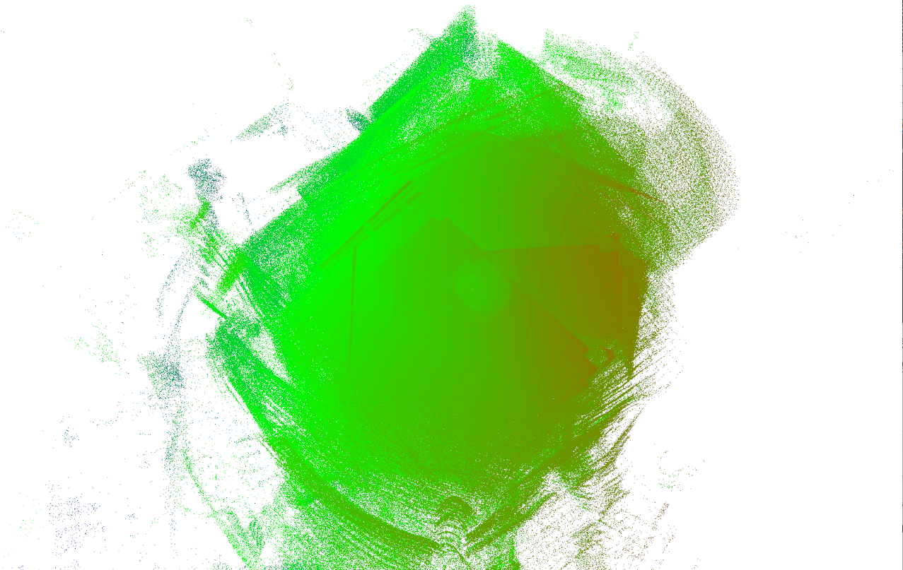
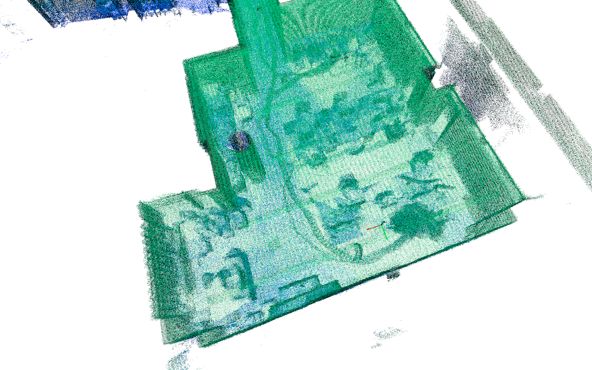
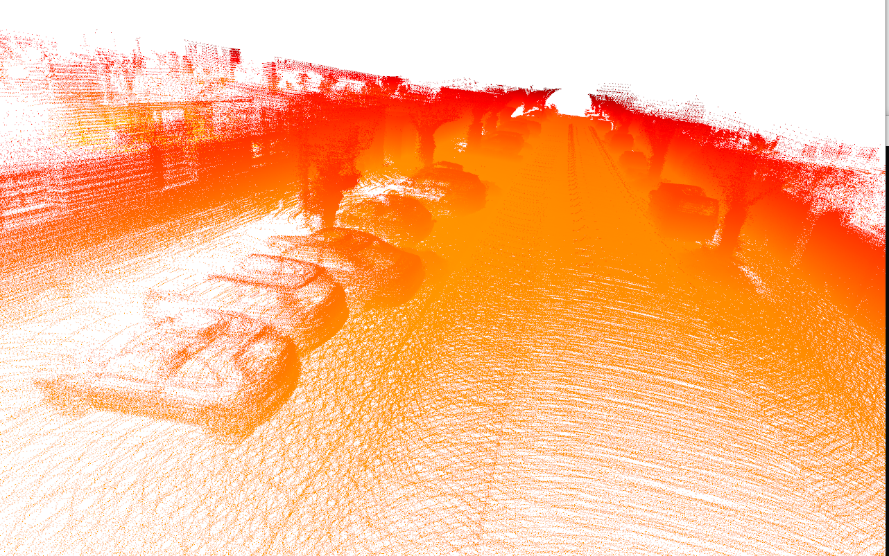
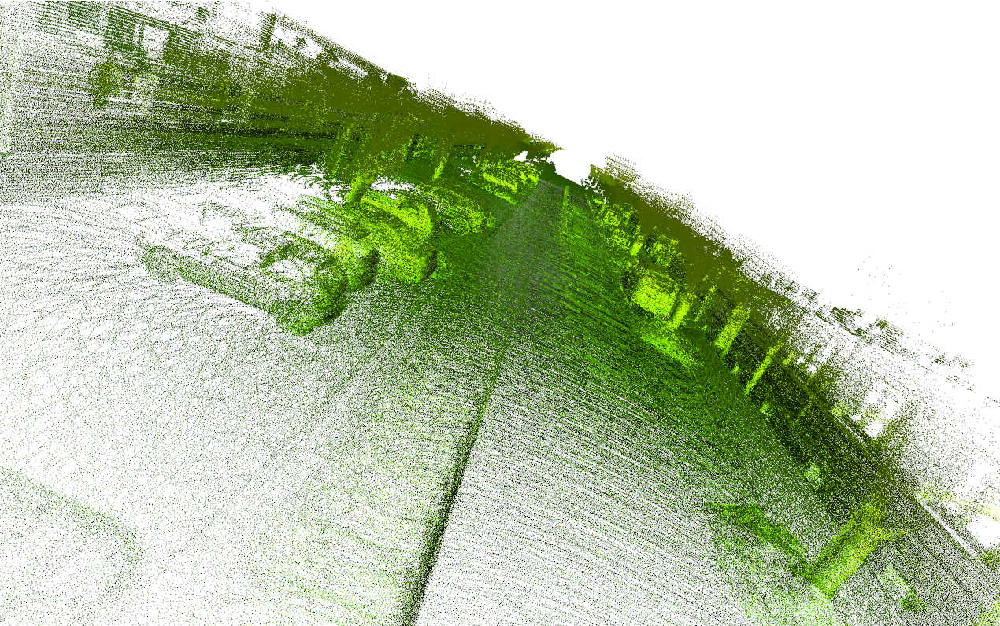
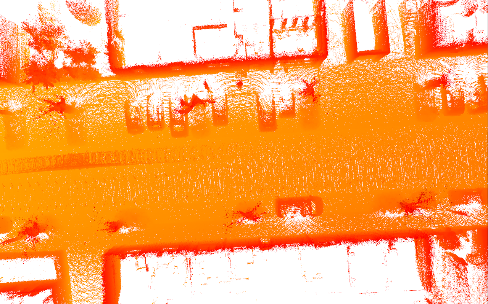
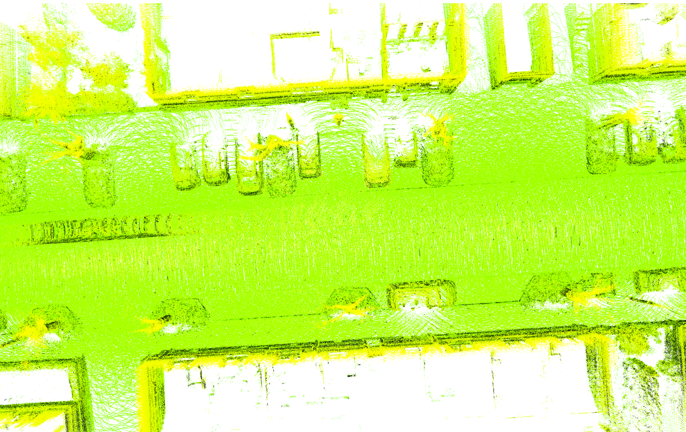
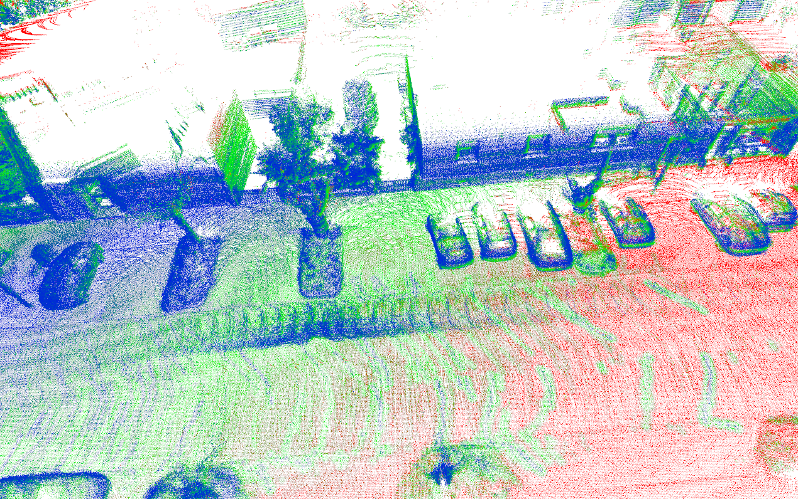

# LiDAR Indoor Mapping — Pose-Free Point Cloud Registration

> Incrementally build dense indoor maps from raw LiDAR scans **without any initial pose estimate** (no IMU, no wheel odometry, no quaternion file required).

---

## Background

Most LiDAR SLAM pipelines rely on an initial pose guess — typically from IMU integration or
wheel encoders — to seed frame-to-frame registration. In practice, this assumption often breaks down:

- **Unreliable initial poses**: IMU drift, magnetic interference, or poor calibration can
  produce initial quaternions that are significantly off, causing cascading alignment errors
  that no downstream ICP step can recover from.
- **Missing initial poses entirely**: Handheld scanners, low-cost robots, and retrofitted
  systems frequently lack the sensor fusion hardware needed to generate a pose prior at all.

Naively stacking frames with a flawed or absent pose prior produces the kind of structural
collapse shown on the left below — walls fold into each other, corridors smear, and the
map is unusable.

This project treats the initial pose as **untrusted or unavailable**, and answers the question:

> *Given only a sequence of raw LiDAR frames, how accurately can we reconstruct an indoor
> map — using point cloud geometry alone?*

The approach relies entirely on **geometric features extracted from the scans themselves** —
FPFH descriptors, plane constraints, and submap-based registration — with no external pose
information at any stage.

---

| Initial pose error (naive stacking) | Mode C — geometry only |
|---|---|
|  |  |

## What Makes This Different

### 1. Cold-start via FPFH + Fast Global Registration
Each frame pair is initialized using FPFH feature descriptors and Fast Global Registration (FGR), eliminating the need for an initial pose guess. When FGR confidence is low (fitness < threshold), the system falls back to an identity transform — a safe assumption for consecutive frames with small motion.

### 2. Plane-Constrained ICP (Mode B / C)
Indoor scenes are rich in flat surfaces (walls, floors, ceilings). After GICP coarse alignment, dominant planes are detected via RANSAC and injected as virtual point constraints. This keeps the registration geometrically grounded and significantly reduces drift along featureless corridors.

### 3. Submap-Based Local Registration + Loop Closure (Mode C)
Instead of aligning each frame against only its predecessor, each new frame is registered against a **local submap** built from the K most recent frames. This reduces accumulated noise per step. A global FPFH descriptor triggers loop closure candidates; confirmed loops feed into a lightweight pose-graph optimisation to correct long-range drift.

---

## Results

The following comparison uses the [Dynamic Mapping Benchmark](https://kth-rpl.github.io/DynamicMap_Benchmark/data/) (VLP-64).

| | No Registration (raw stacked) | Mode A (FGR+GICP) | Mode C (Submap+Loop) |
|---|---|---|---|
| Chamfer Distance ↓ | ~0.46 | ~0.11m | ~0.08m |
| F1 @ 0.1m ↑ | ~0.45 | ~0.71 | ~0.89 |

**Visual comparison:**

| GT | Mode C output |
|---|---|
|  |  |
|  |  |

**Error heatmap:**



---

## Quick Start

**Training (map building):**
```bash
python lidar_train.py
# Select PCD folder → choose Mode C → Start
```
**Visualisation & Analysis:**
```bash
python lidar_visualize.py
# Load the output .pcd → Viewer / Editor / Analysis tabs
```
**Evaluate against ground truth:**
```bash
python eval_pcd.py aligned_map.pcd gt_map.pcd --heatmap --histogram
```
